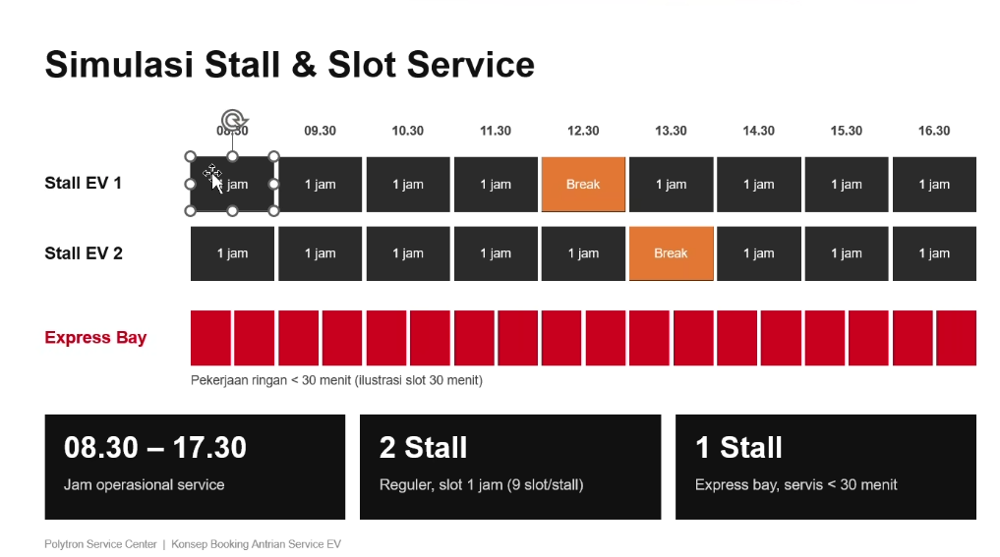

# Polytron EV Service Center - Sistem Simulasi & Booking Antrian EV

Aplikasi sistem booking antrian dan simulasi stall berbasis Web & Progressive Web App (PWA) untuk **Polytron Service Center (EV)**. Desain dan kriteria waktu dibuat 100% mengikuti spesifikasi konsep:



---

## ⚡ Kriteria & Fitur Utama

### 1. Spesifikasi Stall & Alokasi Waktu
- **Jam Operasional**: 08.30 – 17.30 (9 Jam Operasional).
- **2 Stall Reguler** (Durasi pengerjaan ~1 jam per slot):
  - **Stall EV 1**: 08.30, 09.30, 10.30, 11.30, **12.30 (Break Teknisi)**, 13.30, 14.30, 15.30, 16.30.
  - **Stall EV 2**: 08.30, 09.30, 10.30, 11.30, 12.30, **13.30 (Break Teknisi)**, 14.30, 15.30, 16.30.
  - *Break bergantian* memastikan bengkel tidak pernah tutup total saat jam istirahat siang.
- **1 Express Bay** (Servis ringan < 30 menit):
  - Terdiri dari **18 slot berdurasi 30 menit** (08.30 s/d 17.30).
  - Khusus servis ringan seperti penggantian kampas rem cepat, cek baut & shockbreaker, cek tekanan angin & ban, cek kelistrikan ringan / spion.

---

### 2. Fitur Aplikasi

1. **Pilihan Site / Cabang Service Center (Multi-Location)**:
   - Pengguna dan Admin dapat beralih antar cabang Polytron Service Center (Tasikmalaya, Bandung, Cirebon, Jakarta, Semarang, Kudus, Surabaya).
   - Setiap site memiliki data antrian, kapasitas slot, dan nomor kontak masing-masing.

2. **Desain Sudut 90 Derajat Tegas (Tidak Lancip)**:
   - Seluruh elemen antarmuka (kartu, kotak stall, input form, tombol, badge, tabel, dan modal) menggunakan sudut **90 derajat presisi** dengan micro-fillet radius halus (2px).
   - Memberikan estetika industri otomotif dan elektronik modern yang rapi, solid, dan tidak tajam menusuk.

3. **Sistem Navigasi "Back" Bertahap / Bertingkat**:
   - **Form Booking Multi-Step Wizard (5 Tahap)**:
     - Tahap 1: Pilih Lokasi Site
     - Tahap 2: Kategori Servis (Reguler vs Express)
     - Tahap 3: Tanggal & Stall
     - Tahap 4: Pilih Jam Slot Kedatangan
     - Tahap 5: Informasi Kendaraan & Pelanggan
     - Setiap tahap dilengkapi tombol **"← Kembali ke Tahap Sebelumnya"** (Back Bertahap) dan **"Lanjut →"** tanpa kehilangan data input.
     - Breadcrumb bar bertingkat di bagian atas untuk navigasi cepat.
   - **Tombol Back Global di Header**:
     - Memudahkan pengguna kembali secara hierarkis (misal: dari Form Booking mundur per-tahap sampai kembali ke layar Simulasi Stall utama).

4. **Tampilan Otomatis HP (Full Layar dengan Padding 1mm) dan Laptop / PC**:
   - **Layar Smartphone / HP**: Otomatis mendeteksi layar ponsel, mengisi 100% lebar layar (Full Layar) dengan **padding tepi tepat 1mm** (`padding: 1mm;`), memaksimalkan luas pandang tanpa border buangan, dilengkapi **Bottom Navigation Bar** untuk kemudahan akses jempol dan horizontal swipe matrix stall yang mulus.
   - **Layar Laptop / PC**: Otomatis membentang menjadi dashboard pemantauan bengkel yang luas dan proporsional (`max-w-7xl`).

5. **Dashboard Simulasi Stall & Slot (Tampilan Admin Bengkel / Service Advisor)**:
   - Visual grid horizontal yang identik dengan slide presentasi konsep Polytron.
   - Kotak slot interaktif (Kosong -> input Walk-in, Terisi -> detail pelanggan & chat WhatsApp, Break -> istirahat).

6. **Penerbitan e-Tiket Digital & Manajemen Antrian**:
   - e-Tiket dengan QR Code, kode booking unik, lokasi cabang, jam kedatangan, dan filter antrian real-time.

---

## 🚀 Cara Menjalankan

### Cara 1: Buka Langsung (Paling Cepat)
Cukup klik ganda (double-click) file:
```
start.bat
```
atau buka file `index.html` dengan peramban (Google Chrome, Microsoft Edge, atau Firefox).

### Cara 2: Menjalankan via Local Web Server (Mendukung PWA Service Worker)
Buka terminal PowerShell / Command Prompt di folder ini, lalu jalankan:
```bash
py server.py
```
Aplikasi akan otomatis terbuka di browser pada alamat `http://localhost:8080`.

---

## 📱 Cara Mengubah Menjadi File APK Android

Aplikasi ini sudah dilengkapi dengan `manifest.json` dan `sw.js` (Progressive Web App). Ada beberapa cara mudah untuk mengubahnya menjadi APK:

### Opsi A: Langsung "Install" di Smartphone (PWA)
1. Hosting folder ini di hosting gratis seperti **GitHub Pages**, **Vercel**, atau **Netlify**.
2. Buka link tersebut di Google Chrome pada HP Android.
3. Klik ikon titik tiga di Chrome -> Pilih **"Tambahkan ke Layar Utama" (Install App)**.
4. Aplikasi akan terpasang di HP dengan ikon, splash screen, dan berjalan layaknya APK mandiri tanpa URL bar.

### Opsi B: Build APK Menggunakan PWABuilder (Gratis & Cepat)
1. Unggah web ke hosting (misal Netlify).
2. Kunjungi [PWABuilder.com](https://www.pwabuilder.com/).
3. Masukkan URL web Anda, lalu klik **"Package for Android"**.
4. Unduh file `.apk` atau `.aab` yang siap dipasang langsung di HP Android.

### Opsi C: Bungkus Menggunakan Capacitor (Native Android Studio APK)
Jika membutuhkan APK murni yang dapat dikompilasi di Android Studio:
```bash
npm init -y
npm install @capacitor/core @capacitor/cli @capacitor/android
npx cap init "Polytron EV" "com.polytron.evbooking" --web-dir .
npx cap add android
npx cap open android
```
Di Android Studio, klik menu **Build > Build Bundle(s) / APK(s) > Build APK(s)**.
